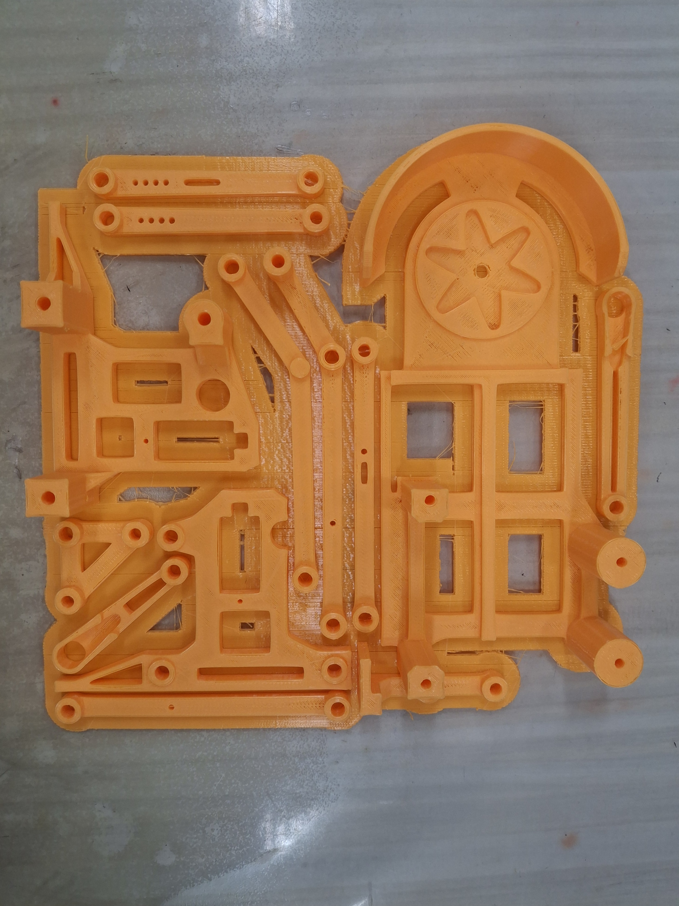

<h1>
  pwp-MeArm-4Axis
</h1>

> [!WARNING]
> 此專案正在進行中，資料可能有不完整部分。

## 專案簡介
本專案為高三工程專題，透過工程設計流程 (EDP) 開發一台結合 Arduino 控制與數位製造 (3D列印/雷射切割) 的 MeArm 四軸機械手臂。

## 開發計畫＆目前進度
- [x] 專案建立與主題確定
- [x] 零件繪製與 3D 列印
- [x] 搖桿控制測試
- [x] Arduino 電路模擬搭設
- [x] 組裝及測試各部件運作情形
- [x] 編寫完整動作程式碼
- [ ] 系統測試與工程疊代

## 開發過程紀錄

1.編寫動作程式碼
* arduino 修改及測試 : [程式碼.ino](firmware/test/test01.ino)

## 開發團隊與分工
| 職責分工 | 工作內容 | 負責人 |
| --- | --- | --- |
| 專案經理 (PM) | 負責專案時程控管、GitHub Repository 維護與 README 撰寫 |  |
| 機構工程師 | 負責 Onshape CAD 建模、機構干涉檢查、雷切與 3D 列印製作 |  |
| 電路與韌體工程師 | 負責 Arduino 電路接線、麵包板搭設與搖桿/伺服馬達驅動程式撰寫 |  |
| AI 與控制邏輯工程師 | 負責 AI Prompt 提問紀錄、控制邏輯優化與故障診斷分析 |  |
